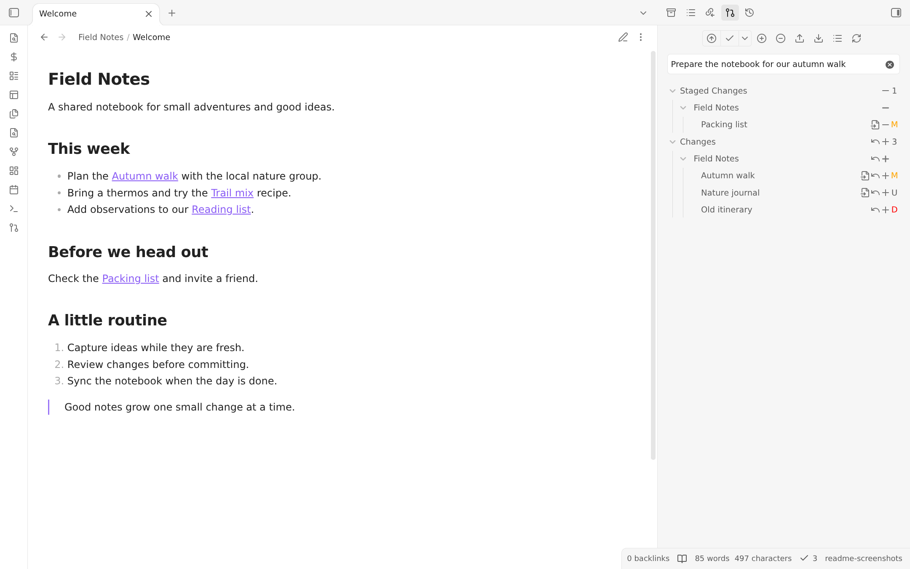
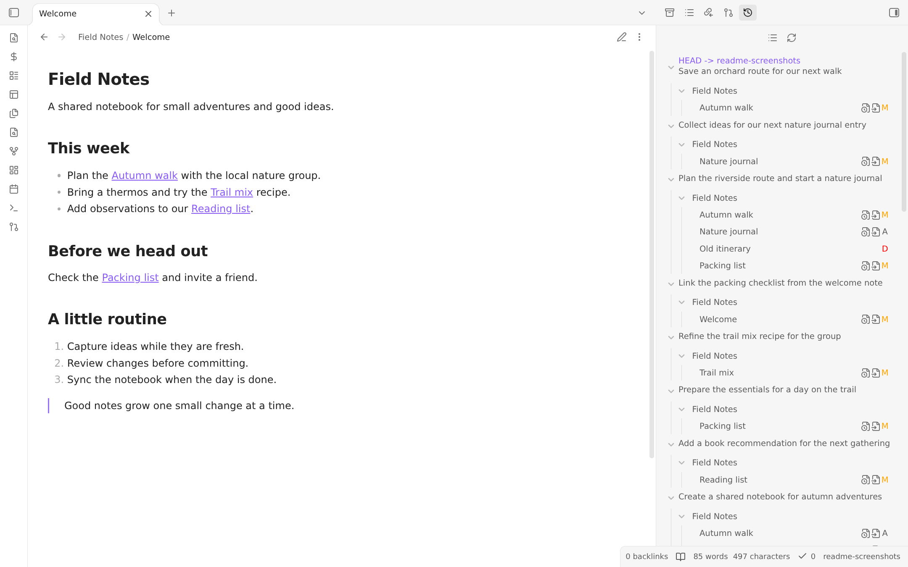
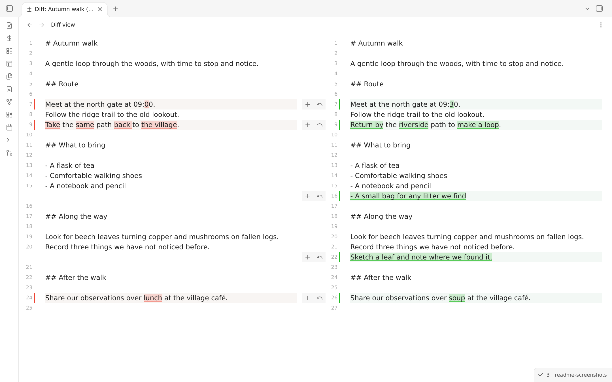
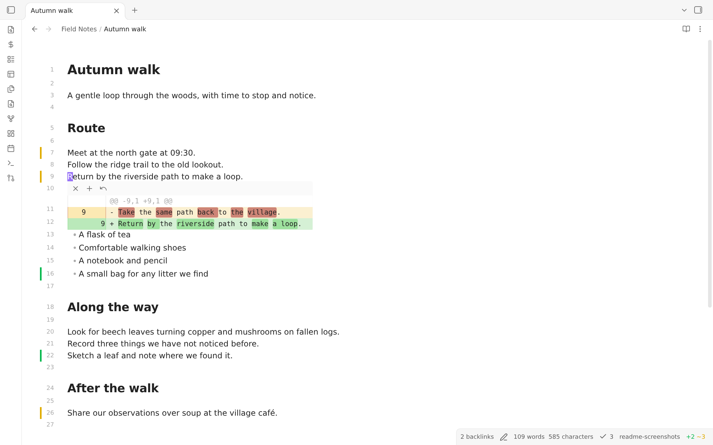
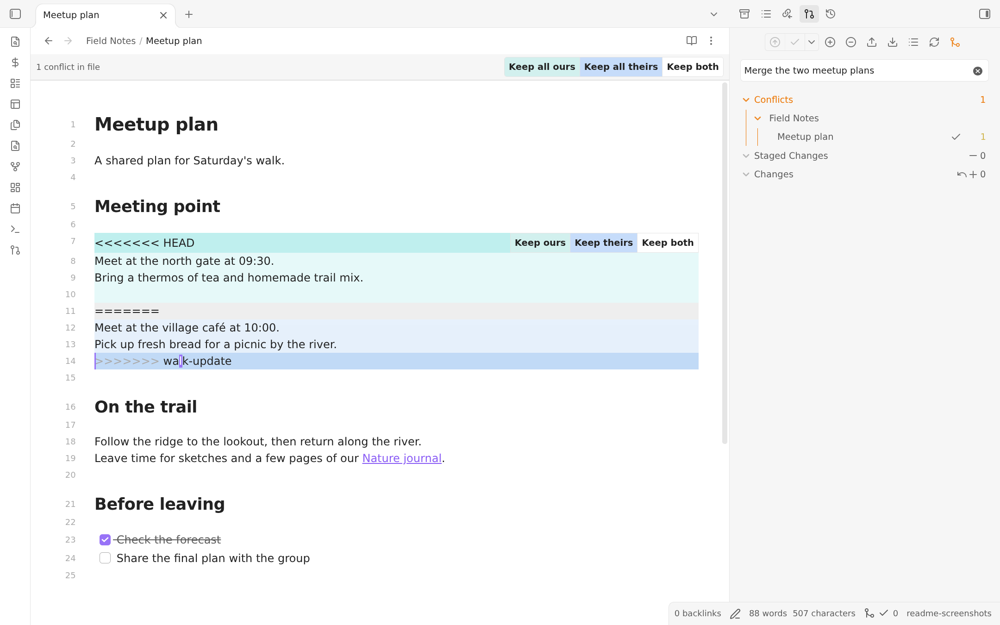
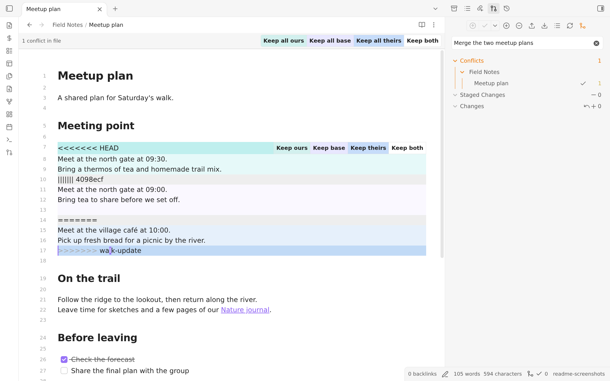

# Git Plugin for Obsidian

A powerful community plugin for [Obsidian.md](https://obsidian.md) that brings Git integration right into your vault. Automatically commit, pull, push, and see your changes — all within Obsidian.

## Documentation

All setup instructions (including mobile), common issues, tips, and advanced configuration can be found in the [full documentation](https://publish.obsidian.md/git-doc).

> Mobile users: The plugin is **highly unstable**. Please check the dedicated [Mobile](#mobile-support-experimental) section below.

## Key Features

- 🔁 **Automatic commit-and-sync** (commit, pull, and push) on a schedule.
- 📥 **Auto-pull on Obsidian startup**
- 📂 **Submodule support** for managing multiple repositories (desktop only and opt-in)
- 🔧 **Source Control View** to stage/unstage, commit and diff files - Open it with the `Open source control view` command.
- 📜 **History View** for browsing commit logs and changed files - Open it with the `Open history view` command.
- 🔍 **Diff View** for viewing changes in a file - Open it with the `Open diff view` command.
- 📝 **Signs in the editor** to indicate added, modified, and deleted lines/hunks (desktop only).
- 🤖 **AI conflict resolution** (optional, off by default): resolves merge conflicts with the Claude API, then lists what it changed and flags large or risky edits for review.
- **Automatic commit-and-sync** (commit, pull, and push) on a schedule.
- **Auto-pull on Obsidian startup**
- **Source Control View** to stage/unstage, commit and diff files - Open it with the `Open source control view` command.
- **History View** for browsing commit logs and changed files - Open it with the `Open history view` command.
- **Diff View** for reviewing changes side by side and staging or resetting individual hunks - Open it with the `Open diff view` command.
- **Conflict resolution in the editor** with highlighted changes and buttons to keep either version, both versions, or the common ancestor when available.
- **Signs in the editor** to indicate added, modified, and deleted lines/hunks (desktop only).
- **Submodule support** for managing multiple repositories (desktop only and opt-in)
- GitHub integration to open files and history in your browser

> For detailed file history, consider pairing this plugin with the [Version History Diff](obsidian://show-plugin?id=obsidian-version-history-diff) plugin.

## UI Previews

### Source Control View

Manage your file changes directly inside Obsidian, including staging and unstaging individual files and committing them. The main Commit action commits staged changes when present. The actions menu provides explicit staged-only and all-changes alternatives, plus amending the previous commit on desktop.

### History View

Show the commit history of your repository. The commit message, author, date, and changed files can be shown. Author and date are disabled by default as shown in the screenshot, but can be enabled in the settings.

### Diff View

Compare versions side by side with highlighted changes. Review, stage, or reset individual hunks without leaving the diff view.
Open it from the source control view or via the `Open diff view` command.

### Signs in the Editor

View line-by-line changes directly in Live Preview with added, modified, and deleted line/hunk indicators. You can stage and reset changes right from the signs. There are also commands to navigate between hunks and stage/reset hunks under the cursor. Needs to be enabled in the plugin settings.

### Conflict Resolution

Resolve conflicting changes in Live Preview without leaving your note. Highlighted sections show your version and the incoming version, with buttons to keep ours, theirs, or both. The bar at the top lets you apply a choice to every conflict in the file. Source Control lists conflicted files and shows how many conflict blocks remain.

When Git includes the common ancestor (for example, with `merge.conflictStyle=diff3`), you can also compare and keep the base version.

After reviewing the result, mark the file as resolved in Source Control, then commit to finish the merge. See the [conflict resolution guide](https://publish.obsidian.md/git-doc/Conflict+resolution) for the full workflow.

## Available Commands

> Not exhaustive - these are just some of the most common commands. For a full list, see the Command Palette in Obsidian.

- Changes
  - `List changed files`: Lists all changes in a modal
  - `Open diff view`: Open diff view for the current file
  - `Stage current file`
  - `Unstage current file`
  - `Discard all changes`: Discard all changes in the repository
- Commit
  - `Commit`: Commits staged changes when present. If nothing is staged, either stages and commits all changes or stops, depending on the `Stage all changes when nothing is staged` setting
  - `Commit with specific message`: Same as above, but with a custom message
  - `Commit all changes`: Commits all changes without pushing
  - `Commit all changes with specific message`: Same as above, but with a custom message
- Commit-and-sync
  - `Commit-and-sync`: With default settings, this will commit all changes, pull, and push
  - `Commit-and-sync with specific message`: Same as above, but with a custom message
  - `Commit-and-sync and close`: Same as `Commit-and-sync`, but if running on desktop, will close the Obsidian window. Will not exit Obsidian app on mobile.
- Remote
  - `Push`, `Pull`
  - `Edit remotes`: Add new remotes or edit existing remotes
  - `Remove remote`
  - `Clone an existing remote repo`: Opens dialog that will prompt for URL and authentication to clone a remote repo
  - `Open file on GitHub`: Open the file view of the current file on GitHub in a browser window. Note: only works on desktop
  - `Open file history on GitHub`: Open the file history of the current file on GitHub in a browser window. Note: only works on desktop
- Manage local repository
  - `Initialize a new repo`
  - `Create new branch`
  - `Delete branch`
  - `CAUTION: Delete repository`
- Miscellaneous
  - `Open source control view`: Opens side pane displaying [Source control view](#source-control-view)
  - `Open history view`: Opens side pane displaying [History view](#history-view)
  - `Edit .gitignore`
  - `Add file to .gitignore`: Add current file to `.gitignore`

## Desktop Notes

### Community scorecard

The [Obsidian community scorecard](https://community.obsidian.md/plugins/obsidian-git#scorecard) reports automated code checks, including warnings about shell execution and direct filesystem access. On desktop, this plugin needs those capabilities to run your installed Git and work with repository metadata and Git configuration beyond Obsidian's vault API. These requirements contribute to the Review rating, so read it alongside the individual findings and in the context of native Git integration.

### Authentication

Some Git services may require further setup for HTTPS/SSH authentication. Refer to the [Authentication Guide](https://publish.obsidian.md/git-doc/Authentication)

### 🤖 AI conflict resolution (optional)

Off by default. When enabled, merge and rebase conflicts during sync are resolved by Claude file by file, committed and pushed with the rest of the sync. This includes files one side edited while the other moved or deleted them, and files too large to send whole (those are resolved one conflict at a time). Every resolved file is listed in a notice; resolutions that change a lot (large deletions, edits to the same numbers, links or code on both sides, low model confidence) are flagged so you can review or revert them with Git.

1. Create an API key in the [Anthropic Console](https://console.anthropic.com/) and make sure the account has credit.
2. Go to **Settings → Git → AI conflict resolution**, enable it, then in **Anthropic API key** click the secret picker and choose **Create new secret** (paste the key and name it). The key is kept in Obsidian's secret storage, never in your vault or repository.
3. Pick a model (a Sonnet-class model is the default; a Haiku-class model is cheaper, an Opus-class model is stronger for hard conflicts) and press **Test connection**.

Each resolution uses API tokens billed to your Anthropic account. Only the conflicted file contents are sent to the Anthropic API. If the key is missing or rejected, credit runs out, you are offline, or the result fails validation, nothing is guessed: the affected files are left for you to resolve manually, and the feature turns itself off (until you re-enable it) when the key is rejected or credit runs out. Files that can't be resolved are left for you, while the rest are still resolved. Moved/deleted-file conflicts and rebases need the desktop app; text conflicts in a merge also work on mobile.

### Obsidian on Linux

- Snap is not supported due to its sandboxing restrictions.
- Flatpak is not recommended, because it doesn't have access to all system files. They are actively fixing many issues, but there are still issues. Especially with more advanced setups.
- Please use AppImage or a full access installation of your system's package manager instead ([Linux installation guide](https://publish.obsidian.md/git-doc/Installation#Linux))

## Mobile Support (Experimental)

The Git implementation on mobile is **very unstable**! I would not recommend using this plugin on mobile, but try other syncing services.

One such alternative is [GitSync](https://github.com/ViscousPot/GitSync), which is available on both Android and iOS. It is not associated with this plugin, but it may be a better option for mobile users. A tutorial for setting it up can be found [here](https://viscouspotenti.al/posts/gitsync-all-devices-tutorial).

> The Git plugin works on mobile thanks to [isomorphic-git](https://isomorphic-git.org/), a JavaScript-based re-implementation of Git - but it comes with serious limitations and issues. It is not possible for an Obsidian plugin to use a native Git installation on Android or iOS.

### Mobile Feature Limitations

- No **SSH authentication** ([isomorphic-git issue](https://github.com/isomorphic-git/isomorphic-git/issues/231))
- Limited repo size, because of memory restrictions
- No rebase merge strategy
- No submodules support

### Performance Caveats

> [!caution]
> Depending on your device and available free RAM, Obsidian may
>
> - crash on clone/pull
> - create buffer overflow errors
> - run indefinitely.
>
> It's caused by the underlying git implementation on mobile, which is not efficient. I don't know how to fix this. If that's the case for you, I have to admit this plugin won't work for you. So commenting on any issue or creating a new one won't help. I am sorry.

### Tips for Mobile Use:

If you have a large repo/vault I recommend staging individual files and setting automatic commit globs to Include matches with an empty list, so automatic commits use only staged files.

## Contact & Credits

- The Line Authoring feature was developed by [GollyTicker](https://github.com/GollyTicker), so any questions may be best answered by her.
- This plugin was initially developed by [denolehov](https://github.com/denolehov). Since March 2021, it's me [Vinzent03](https://github.com/Vinzent03) who is developing this plugin. That's why the GitHub repository got moved to my account in July 2024.
- If you have any kind of feedback or questions, feel free to reach out via GitHub issues.

## Support

If you find this plugin useful and would like to support its development, you can support me on Ko-fi.

